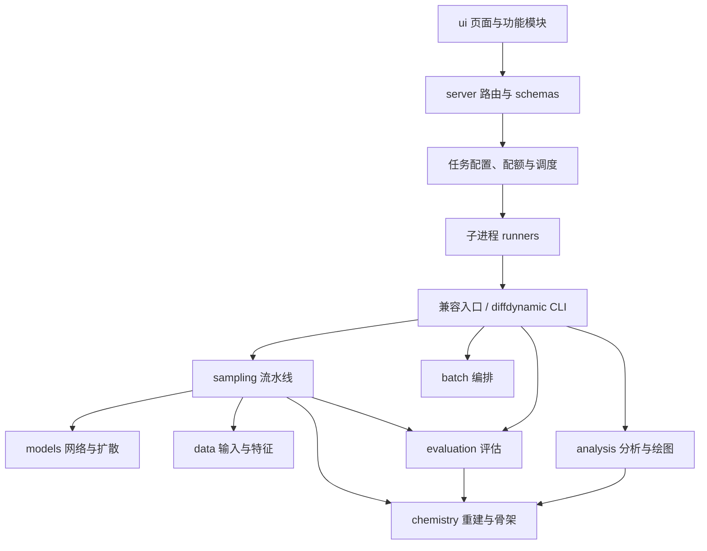

# DiffDynamic 架构与维护边界

## 调用关系

计算库不依赖 Web 或 CLI 实现。兼容模块连接旧名称与当前实现，不保存第二份算法。
`diffdynamic._compat` 将历史模块读取与测试替换转发到定义模块；新代码直接导入职责模块。

## 模型、生成与化学处理

- 模型概率、调度、网络、训练计算和采样分别维护，无参数 mixin 不改变注册层级。
- 生成拆为参数、输入、候选、Prudent、骨架及模式流水线，helper registry 明确列出依赖。
- 位点拆为提取、分配、高斯投放、片段/口袋几何、侧链保留与最终投放。
- 重建拆为连接、芳香性、骨架约束、修复与流程；冻结重建文件不得格式化。
- 数据容器保留 `datasets.pl_data.ProteinLigandData` 的历史 pickle 名称。

## 评估、批量与分析

- PT 评估依次执行 preparation、execution、finalization，以 dataclass context 传递状态。
- 单分子评分、隔离 worker、文件写入与历史记录独立，采样不再反向导入评估 CLI。
- 口袋指标与绘图分离，维持原维度、权重、阈值和缓存策略。
- 批量分为资源、配置、结果发现、采样/评估任务、汇总与可选 benchmark。
- PT 字段、目录名、SDF 属性、Excel 工作表及 stdout 进度文本均为兼容接口。

## Web 与前端

- `server.api` 保留 app 和旧导出，9组路由通过动态依赖提供器使用服务。
- schemas 独立于 API，任务配置独立于调度，提交实现按生成、评估、骨架分组。
- 继续使用单进程队列、GPU/CPU 池与原配额，不直接启用多 uvicorn worker。
- 预览与采样使用相同 helper，保留旧私有函数替换兼容性。
- 工作台按功能拆 classic scripts，首页拆 ESM、样式与分子数据。
- DOM、全局事件、静态路径、平台注入及中英文前缀保持兼容。

## 数据与历史任务

历史脚本不再修旧路径，通过本地位置表定位；数据按课题保留完整结果树。
数据库、上传、在用结果、默认汇总及活动任务引用的课题树保留原位。
迁移采用同文件系统、不覆盖的 rename，保持链接身份并记录目标更新与回滚。
